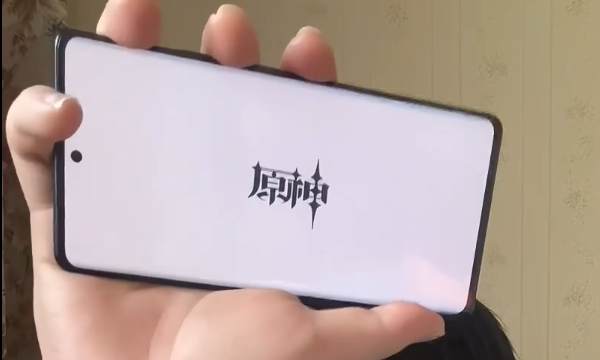

# 原神开机动画（KernelSU）



把 1440x3200 母版按手机分辨率打包成开机动画模块。小米 13（1080x2400 / HyperOS 3）、
小米 17（1220x2656 / HyperOS 4）实测通过。

## 前置要求：Hybrid Mount

KernelSU 3.x 起自己不做挂载，模块的 `system/` 要靠 metamodule 挂上去。**没有 metamodule 就装不上**，
`customize.sh` 会直接 `abort`。

而且 `/system/media` 是 `/product/media` 的软链，只有能跟随软链的 magic mount 才能覆盖过去——
实测只有 **Hybrid Mount** 可以，所以推荐用它。

| 当前 metamodule | 结果 |
| --- | --- |
| 没装 / 被禁用（含软链断了） | 安装被拦，不会留下半装的模块 |
| **Hybrid Mount** | 正常安装（推荐） |
| meta-overlayfs 等其它实现 | 允许安装，但可能覆盖不到 `/product/media`，没效果就换 Hybrid Mount |

正确顺序：装 Hybrid Mount → 重启 → 装本模块 → 重启。

重启后确认挂上了没有：`stat -c %s /system/media/bootanimation.zip`，大小应该和
`/data/adb/modules/genshin_bootanim/system/media/bootanimation.zip` 一致。

## 生成自定义分辨率帧率模块

```bash
uv sync
uv run src/build.py                       # 不传分辨率 = 母版 1440x3200，输出 build/genshin-bootamin.zip
uv run src/build.py 1080x2400              # 指定分辨率
uv run src/build.py 1440x3200 --fps 24    # 降帧率减小体积
```

装法：KernelSU → 模块 → 从本地安装 → 选 `build/genshin-bootamin.zip` → 重启（Hybrid Mount 要先装好）。

只支持 KernelSU（实测环境：KernelSU + Hybrid Mount），**不支持 Magisk**：模块 zip 不带
`META-INF/` 安装脚本，开机脚本里的模块路径和挂载行为也只在 KernelSU 上验证过。

## 用 GitHub Actions 打包

Fork → Actions → `build` → Run workflow，填 `resolution`（`adb shell wm size` 里的 Physical size）、
`fps`。产物是 artifact 里的 **`genshin-bootamin.zip`**——artifact 本身是个压缩包，要先解压。

## 规则

| | |
| --- | --- |
| 分辨率 | 命令行传入，cover 缩放：一条边齐平、另一边居中裁掉，不留黑边 |
| 方向 | 跟随母版，不旋转 |
| 帧率 | 默认 30，可降到 1–30，总时长固定 6 秒 |
| 画面 | 8-bit 灰度 PNG，64 级量化；180 帧去重后 13 parts / 136 文件 |
| 音频 | 10 秒，尾部 2 秒淡出已烘进文件；静音在 WebUI 里开关 |

宽高比越接近母版的 9:20，裁得越少。

## 模块内容

```
module.prop                        id 固定，换分辨率重装是更新
customize.sh                       检查 metamodule（缺了直接中断安装）+ 分辨率提示
post-fs-data.sh                    按配置设开机音属性、铺 MIUI 主题音源
uninstall.sh                       还原属性 + 删掉铺过去的音效
webroot/                           WebUI 产物（配置页，来自 webui/dist/）
system/media/bootanimation.zip     desc.txt + partN + audio.wav（AOSP 用）
files/bootaudio.mp3                MIUI 的开机音源
```

三个 `.sh` 的源码在 `src/ksu-scripts/`，打包时替换 `__ID__` / `__SIZE__` / `__MD5__` 占位符。

只写 `/system/media`，不要往模块里加 `product/`——会让整块模块挂不上。

开机音的位置随系统不同：

| 系统 | 音源 | 读取方式 |
| --- | --- | --- |
| AOSP | `part0/audio.wav`（在 zip 里） | `audioplay` |
| MIUI / HyperOS | `/data/system/theme/boots/bootaudio.mp3` | `playBackgroundMusic`，由脚本每次开机铺 |

静音统一由两个属性控制（`persist.sys.bootanim.play_sound`、`persist.sys.boot_audio.enabled`），
由 `post-fs-data.sh` 按 `/data/adb/genshin_bootanim/config.conf` 的 `SILENT` 设置，
卸载时还原。

## WebUI

`webui/` 是配置页源码（React + TypeScript + MUI + Vite），构建产物在 `webui/dist/`（不入库）；
`src/build.py` 把 `webui/dist/` 整个目录打进模块的 `webroot/`，自己不跑 npm。
GitHub Actions 会先构建 WebUI 再打模块；本地需要先手动构建一次：

```bash
cd webui && npm ci && npm run build   # 产物输出到 webui/dist/
```

## 版本号

改 `pyproject.toml` 的 `version`，`versionCode` 自动推导（`1.0.1` → `10001`）。

